<!-- Perfil de GitHub de Ulises Agustín Rodríguez. Repo: UlisesSB/UlisesSB -->

  

<b>🇦🇷 Español</b>

 

Estudiante avanzado de **Ingeniería en Computación** en la **UNT-FACET** (Tucumán, Argentina). Me muevo entre el hardware y el software: **sistemas embebidos, firmware, electrónica, redes e IA aplicada**. Presido la **Rama Estudiantil IEEE** de FACET-UNT. Antes de la ingeniería me formé como Maestro Mayor de Obras, oficio que sigo ejerciendo de forma independiente.

<table align="center"><tr>
<td align="center" width="33%"><h3>🎓</h3><b>FORMACIÓN</b> Ing. en Computación · UNT-FACET</td>
<td align="center" width="33%"><h3>🔧</h3><b>FOCO</b> Embedded · Firmware · Hardware</td>
<td align="center" width="33%"><h3>📍</h3><b>UBICACIÓN</b> Aguilares, Tucumán 🇦🇷</td>
</tr></table>

<b><code>Embebidos y hardware</code></b> 

<b><code>Lenguajes y datos</code></b> 

<b><code>Redes</code></b> 

<b><code>Herramientas</code></b> 

<table>
<tr>
<td valign="top" width="50%">
<b><code>PRJ.01</code> · PERSONAL · OPEN SOURCE</b>
<h3>Ambilight "UlumiGlow"</h3>

Iluminación ambiental sincronizada con la pantalla, de punta a punta: electrónica, firmware y software de escritorio. Instalador de Windows distribuido en GitHub Releases.

<code>ESP32</code> <code>PWM</code> <code>Python</code> <code>PCB</code>

<a href="https://uarodriguez.com/proyectos/ulumiglow.html">Ficha técnica →</a> &nbsp;·&nbsp; <a href="https://github.com/UlisesSB/UlisesGlow">Repositorio</a>

</td>
<td valign="top" width="50%">
<b><code>PRJ.02</code> · ACADÉMICO</b>
<h3>Sistema de gestión para transporte (RISC-V)</h3>

Diseño teórico y simulación de un sistema embebido de transporte público: cobro por RFID, conteo de pasajeros por GPS y disponibilidad de asientos en tiempo real.

<code>RISC-V</code> <code>Assembly</code> <code>SPI</code> <code>RFID</code>

<a href="https://uarodriguez.com/proyectos/transporte-riscv.html">Ficha técnica →</a>

</td>
</tr>
<tr>
<td valign="top" width="50%">
<b><code>PRJ.03</code> · ACADÉMICO</b>
<h3>Clasificación binaria de gliomas en MRI</h3>

Clasificación de gliomas en resonancias cerebrales con arquitecturas YOLO, validada con cinco pruebas experimentales incrementales y mapas de calor para interpretación.

<code>YOLO</code> <code>Python</code> <code>Deep Learning</code>

<a href="https://uarodriguez.com/proyectos/mri-glioma-yolo.html">Ficha técnica →</a>

</td>
<td valign="top" width="50%">
<b><code>PRJ.04</code> · ACADÉMICO</b>
<h3>"Signal" — Circuito audiorrítmico</h3>

Circuito 100% analógico: ajusta el volumen y activa luces reactivas a agudos, medios y graves. Diseño, placas de cobre, soldadura y carcasa impresa en 3D.

<code>Analog</code> <code>PCB</code> <code>3D printing</code>

<a href="https://uarodriguez.com/proyectos/signal.html">Ficha técnica →</a>

</td>
</tr>
<tr>
<td valign="top" width="50%">
<b><code>PRJ.05</code> · ACADÉMICO</b>
<h3>Arquitectura de base de datos para e-commerce</h3>

Base de datos híbrida SQL/NoSQL con roles de usuario, consultas analíticas y hashing SHA-256 con salt.

<code>SQL</code> <code>MongoDB</code> <code>SHA-256</code>

<a href="https://uarodriguez.com/proyectos/db-ecommerce.html">Ficha técnica →</a>

</td>
<td valign="top" width="50%">
<b><code>PRJ.06</code> · ACADÉMICO</b>
<h3>Sistema de gestión gastronómico</h3>

Aplicación web para gestionar un establecimiento gastronómico, cubriendo todo el ciclo de ingeniería de software: de los requisitos a la implementación.

<code>Web app</code> <code>DB design</code> <code>UML</code>

<a href="https://uarodriguez.com/proyectos/gestion-gastronomica.html">Ficha técnica →</a>

</td>
</tr>
</table>

- **Presidente — IEEE, Rama Estudiantil FACET-UNT**  
  Desde junio 2026. Formación técnica, eventos y representación institucional.
- **Coordinador y expositor — Stand de Ing. en Computación, “Exactas para Todos”**  
  Agosto 2026. Producción y atención del stand de la carrera en la muestra anual de la facultad.
- **Equipo de organización — Muestra “Exactas para Todos”**  
  Ediciones 2024 y 2025. Logística general y apoyo a los departamentos de ingeniería.
- **SASE 2026 — Simposio Argentino de Sistemas Embebidos**  
  Agosto 2026. Representación de IEEE FACET-UNT y participación en talleres técnicos de sistemas embebidos.

 

<b>🇬🇧 English</b>

 

Advanced **Computer Engineering** student at **UNT-FACET** (Tucumán, Argentina). I work between hardware and software: **embedded systems, firmware, electronics, networking and applied AI**. I chair the **IEEE Student Branch** at FACET-UNT. Before engineering I trained as a Master Builder (Maestro Mayor de Obras), a trade I still practice independently.

<table align="center"><tr>
<td align="center" width="33%"><h3>🎓</h3><b>EDUCATION</b> Computer Eng. · UNT-FACET</td>
<td align="center" width="33%"><h3>🔧</h3><b>FOCUS</b> Embedded · Firmware · Hardware</td>
<td align="center" width="33%"><h3>📍</h3><b>LOCATION</b> Aguilares, Tucumán 🇦🇷</td>
</tr></table>

<b><code>Embedded & hardware</code></b> 

<b><code>Languages & data</code></b> 

<b><code>Networking</code></b> 

<b><code>Tools</code></b> 

<table>
<tr>
<td valign="top" width="50%">
<b><code>PRJ.01</code> · PERSONAL · OPEN SOURCE</b>
<h3>Ambilight "UlumiGlow"</h3>

Ambient lighting synced to on-screen content, end to end: electronics, firmware and desktop software. Windows installer shipped through GitHub Releases.

<code>ESP32</code> <code>PWM</code> <code>Python</code> <code>PCB</code>

<a href="https://uarodriguez.com/proyectos/ulumiglow.html">Project page →</a> &nbsp;·&nbsp; <a href="https://github.com/UlisesSB/UlisesGlow">Repository</a>

</td>
<td valign="top" width="50%">
<b><code>PRJ.02</code> · ACADEMIC</b>
<h3>Transit fare-management system (RISC-V)</h3>

Theoretical design and simulation of an embedded public-transit system: RFID fare collection, GPS-based passenger counting and real-time seat availability.

<code>RISC-V</code> <code>Assembly</code> <code>SPI</code> <code>RFID</code>

<a href="https://uarodriguez.com/proyectos/transporte-riscv.html">Project page →</a>

</td>
</tr>
<tr>
<td valign="top" width="50%">
<b><code>PRJ.03</code> · ACADEMIC</b>
<h3>Binary glioma classification in MRI</h3>

Glioma classification on brain MRI using YOLO architectures, validated through five incremental experiments, with heat maps for interpretability.

<code>YOLO</code> <code>Python</code> <code>Deep Learning</code>

<a href="https://uarodriguez.com/proyectos/mri-glioma-yolo.html">Project page →</a>

</td>
<td valign="top" width="50%">
<b><code>PRJ.04</code> · ACADEMIC</b>
<h3>"Signal" — Audio-reactive circuit</h3>

Fully analog circuit: adjusts volume and drives lights reacting to highs, mids and lows. Design, hand-made copper boards, soldering and a 3D-printed enclosure.

<code>Analog</code> <code>PCB</code> <code>3D printing</code>

<a href="https://uarodriguez.com/proyectos/signal.html">Project page →</a>

</td>
</tr>
<tr>
<td valign="top" width="50%">
<b><code>PRJ.05</code> · ACADEMIC</b>
<h3>Database architecture for e-commerce</h3>

Hybrid SQL/NoSQL database with role-based permissions, analytical queries and salted SHA-256 hashing.

<code>SQL</code> <code>MongoDB</code> <code>SHA-256</code>

<a href="https://uarodriguez.com/proyectos/db-ecommerce.html">Project page →</a>

</td>
<td valign="top" width="50%">
<b><code>PRJ.06</code> · ACADEMIC</b>
<h3>Restaurant management system</h3>

Web application for managing a food-service business, covering the full software-engineering lifecycle: from requirements to implementation.

<code>Web app</code> <code>DB design</code> <code>UML</code>

<a href="https://uarodriguez.com/proyectos/gestion-gastronomica.html">Project page →</a>

</td>
</tr>
</table>

- **Chair — IEEE Student Branch, FACET-UNT**  
  Since June 2026. Technical training, events and institutional representation.
- **Coordinator & presenter — Computer Eng. booth, “Exactas para Todos”**  
  August 2026. Produced and staffed the program’s booth at the faculty’s annual exhibition.
- **Organizing team — “Exactas para Todos” exhibition**  
  2024 and 2025 editions. General logistics and support to the engineering departments.
- **SASE 2026 — Argentine Embedded Systems Symposium**  
  August 2026. Represented IEEE FACET-UNT and attended technical embedded-systems workshops.

 

Si te interesa el hardware, el firmware o IEEE, escribime: · If you are into hardware, firmware or IEEE, get in touch:

<a href="https://uarodriguez.com">uarodriguez.com</a> &nbsp;·&nbsp; <a href="mailto:uarodriguez@computer.org">uarodriguez@computer.org</a> &nbsp;·&nbsp; <a href="https://www.linkedin.com/in/ulises-agustin-rodriguez-a3aa563b5">LinkedIn</a>

 

